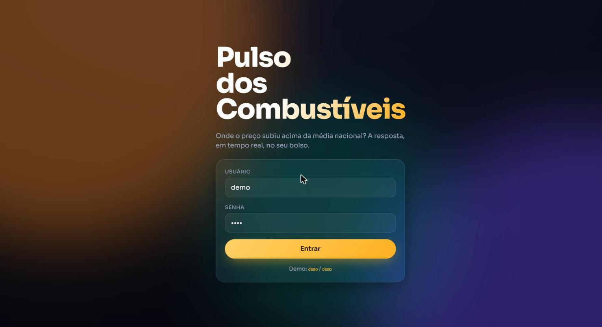
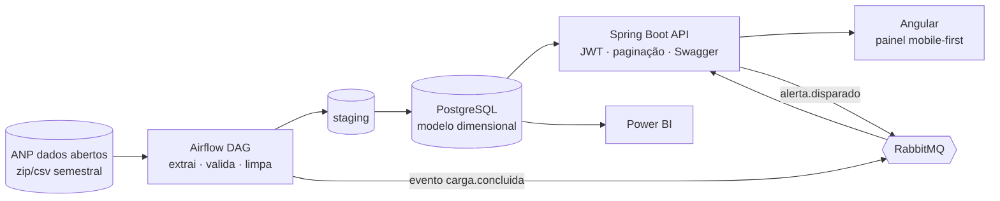

# ⛽ Pulso dos Combustíveis

> **Pergunta de negócio:** *em quais UFs o preço do combustível está acima da média nacional — e como isso evoluiu mês a mês?*

Pipeline de dados ponta a ponta sobre a **série histórica de preços de combustíveis da ANP** (dados abertos, cobertura nacional):
**Airflow (ETL) → PostgreSQL (modelo dimensional) → API Spring Boot → painel Angular mobile-first → Power BI**, mais um **módulo de alertas** com regras de negócio e **mensageria (RabbitMQ)**: o ETL anuncia *carga concluída* e a API avalia as regras de alerta cadastradas.


## Resposta à pergunta de negócio

Exemplo com os dados carregados (gasolina, junho/2026): **18 das 27 UFs** estavam acima da média nacional (R$ 6,66). As maiores altas: **RR +15,3%**, **AC +12,0%** e **RO +10,5%**; as menores, **MG −4,4%** e **RS −3,2%**. O painel permite trocar o produto, tocar numa UF e ver sua série mensal contra o Brasil.

## Telas

| Login | Painel (desktop) | Explorar | Painel (mobile) |
|---|---|---|---|
|  |  |  |  |

## Executar

Pré-requisito: Docker. Portas usadas: `4200`, `8080`, `8081`, `5433`, `5672`, `15672`.

```bash
docker compose up -d --build                                   # 1. sobe tudo
docker compose exec airflow-scheduler airflow dags unpause anp_combustiveis_etl   # 2. ativa a DAG
docker compose exec airflow-scheduler airflow dags trigger anp_combustiveis_etl   # 3. carrega os dados (~3 min)
```

| Serviço | URL | Acesso |
|---|---|---|
| Painel Angular | http://localhost:4200 | `demo` / `demo` |
| API + Swagger | http://localhost:8081/swagger-ui.html | login em `POST /api/v1/auth/login` |
| Airflow | http://localhost:8080 | `admin` / `admin` |
| RabbitMQ (painel) | http://localhost:15672 | `guest` / `guest` |
| PostgreSQL | `localhost:5433` (db `anp`, schema `dw`) | `anp` / `anp` |

> A DAG nasce pausada (padrão do Airflow); também pode ser ativada pela interface. Credenciais acima são **apenas de demonstração**; em outro ambiente defina `JWT_SECRET`, `APP_USER` e `APP_PASSWORD`.

## Arquitetura



| Camada | Pasta | Tecnologia |
|---|---|---|
| ETL | `airflow/dags` | Python 3.12 + Airflow 2.10 |
| Banco | `db/init` | PostgreSQL 16 (star schema, matview, view analítica) |
| API | `api` | Java 21 + Spring Boot 3.4 — monolito modular: `auth`, `preco`, `analise`, `alerta`, `shared` |
| Painel | `web` | Angular 22 — monolito modular: `core`, `shared`, `layout`, `features/*` (rotas lazy) |
| Fila | `docker-compose.yml` | RabbitMQ 3.13 (exchange topic, DLQ) |
| Power BI | `powerbi` | Guia de conexão + medidas DAX |
| CI | `.github/workflows` | GitHub Actions: testes e build da API, do painel e checagem da DAG |

> 📋 Análise de requisitos, regras de negócio e rastreabilidade para testes: [`docs/REQUISITOS.md`](docs/REQUISITOS.md) · 📨 Mensageria (topologia, contratos, falhas): [`docs/MENSAGERIA.md`](docs/MENSAGERIA.md)

> 📐 Documento completo de arquitetura (atores, casos de uso, processos, visões C4, dados, implantação, ADRs, segurança e riscos): [`docs/ARQUITETURA.md`](docs/ARQUITETURA.md)

## Alertas de preço (regras de negócio + fila)

Cadastre "avise-me quando a **gasolina** no **RR** passar **5%** acima da média nacional". Ao fim de cada carga, a DAG publica `carga.concluida` no RabbitMQ; a API consome, avalia as regras ativas, grava **um alerta por regra/mês** (idempotente) e publica `alerta.disparado`. Severidade: `ATENCAO` (<1,5× o limite), `ALTA` (≥1,5×), `CRITICA` (≥2×). Falhas são reenviadas 3× e vão para a **DLQ**.

```bash
curl -X POST localhost:8081/api/v1/alertas/regras -H "Authorization: Bearer $TOKEN" \
  -H 'Content-Type: application/json' -d '{"produto":"gasolina","uf":"rr","limitePct":5}'
curl -X POST localhost:8081/api/v1/alertas/avaliacoes -H "Authorization: Bearer $TOKEN"   # reavalia (assíncrono)
curl localhost:8081/api/v1/alertas -H "Authorization: Bearer $TOKEN"
```

Com os dados carregados, esse exemplo gera um alerta `CRITICA` (RR +15,3%). Em bancos criados antes deste módulo, aplique `db/init/02_alertas.sql` (ver [`docs/MENSAGERIA.md`](docs/MENSAGERIA.md)).

## Modelo de dados

```
dim_data ─┐
dim_produto ─┤
dim_localidade ─┼── fato_preco (data × revenda × produto → preco_venda, preco_compra)
dim_revenda ── dim_bandeira
```

- `dw.mv_preco_mensal_uf`: agregado mensal por UF/produto (materializado, atualizado ao fim da DAG).
- `dw.vw_preco_vs_media_nacional`: view pronta para análise, compara cada UF com a média nacional **ponderada** do mês (`variacao_pct`, `acima_da_media`).
- Índices em `fato_preco (produto_id, data_id)` e `(localidade_id, produto_id)`.

## Decisões de projeto

- **Airflow, não cron:** retries, observabilidade por task, *dynamic task mapping* (um arquivo = uma task) e alerta de falha.
- **Modelo dimensional:** grão = coleta por revenda × produto × dia; consultas analíticas ficam simples e rápidas.
- **Carga incremental:** baixa só semestres ausentes em `dw.etl_controle` mais o semestre corrente (a ANP republica o arquivo vigente). Parâmetro `force=true` reprocessa tudo.
- **Idempotência:** staging é limpo por arquivo antes da carga; dimensões e fato usam `ON CONFLICT … DO NOTHING/UPDATE` na chave natural. **Verificado:** reexecutar com `force` manteve exatamente 1.227.029 linhas na fato.
- **Qualidade de dados:** colunas obrigatórias, faixa de preço (R$ 0,50–30), UF/CNPJ/data válidos; linhas ruins são descartadas e contadas, e a task **falha** se a rejeição passar de 5%. Há checagem pós-carga (fato vazia ou órfã) antes de considerar o run saudável — na primeira execução ela barrou corretamente uma carga vazia.
- **Alerta:** `on_failure_callback` loga e, se `ALERT_WEBHOOK_URL` estiver definido, posta em Slack/Discord/Teams.
- **Monolito modular:** um deploy por camada, com fronteiras claras por módulo (pacotes na API, features lazy no Angular).
- **Auth simples:** login → JWT HS256 stateless. Suficiente para demo; em produção, usar um provedor de identidade.

## Experiência do painel (mobile-first)

Entrada cinematográfica palavra a palavra, fundo em aurora animada, vidro fosco, *scroll reveal* com blur, contadores animados, barras que crescem em cascata, transições de rota via View Transitions API, gráficos com animação e tab bar inferior estilo app. Respeita `prefers-reduced-motion`. Exporta CSV (ranking e coletas).

## Testes e qualidade

| Alvo | Comando | Resultado |
|---|---|---|
| API (regras de negócio, contrato HTTP, segurança, repositórios em H2, mensageria) | `cd api && mvn verify` | 74 testes · **100 % de linhas e de branches** (JaCoCo falha o build abaixo disso; relatório em `api/target/site/jacoco`) |
| Painel (API client, auth, guard, login, animações, CSV) | `cd web && npx ng test --watch=false` | 23 testes |
| ETL (helpers, download, alerta de falha, publicação do evento) | `pip install -r airflow/requirements-dev.txt && python -m pytest airflow/tests` | 24 testes |
| ETL de ponta a ponta | execução real da DAG | 1,2 mi linhas carregadas, idempotência confirmada |
| Fila de ponta a ponta | RabbitMQ + Postgres reais (manual) | regra → evento → consumidor → alerta CRÍTICO, sem duplicar ao reavaliar |

> Sem Maven local? `docker run --rm -v "$PWD/api:/app" -w /app maven:3.9-eclipse-temurin-21 mvn verify`. (no Git Bash do Windows, prefixe com `MSYS_NO_PATHCONV=1`; o Surefire pode registrar um aviso "kill self fork JVM" sem afetar o resultado — o build termina em `BUILD SUCCESS`). Fora do escopo dos testes automatizados: as páginas `dashboard`/`explorer` do painel e um teste com broker real (Testcontainers) — ver riscos em [`docs/ARQUITETURA.md`](docs/ARQUITETURA.md).

O CI roda os mesmos passos a cada push/PR.

## Power BI

Conexão em `localhost:5433`, banco `anp`, view `dw.vw_preco_vs_media_nacional`. Passo a passo, medidas DAX e páginas sugeridas em [`powerbi/README.md`](powerbi/README.md).

## Desenvolvimento local

```bash
docker compose up -d postgres api      # banco e API (API em :8081)
cd web && npm i && npm start           # painel em :4200, com proxy /api → :8081
cd api && mvn verify                   # testes da API
```

## Fonte dos dados

[ANP — Série histórica de preços de combustíveis](https://www.gov.br/anp/pt-br/centrais-de-conteudo/dados-abertos/serie-historica-de-precos-de-combustiveis), dados abertos. A ANP publica `.zip` por semestre (2022 em diante) e `.csv` nos anos anteriores; a DAG trata os dois formatos. Variáveis: `ANP_BASE_URL` e `ANP_FIRST_YEAR` (padrão `2025`, para um demo rápido; use `2023` para mais histórico).
