# Documento de Arquitetura de Software — Pulso dos Combustíveis

| | |
|---|---|
| **Versão** | 1.1 — inclui módulo de alertas e mensageria |
| **Escopo** | Pipeline analítico de preços de combustíveis (ANP): ETL, data warehouse, API, painel web, BI e alertas via fila |
| **Documentos do módulo de alertas** | [Requisitos e regras de negócio](REQUISITOS.md) · [Mensageria](MENSAGERIA.md) |
| **Estilo arquitetural** | Monolito modular por camada (um deploy por camada, módulos internos isolados) |
| **Leia também** | [README](../README.md) · [Guia Power BI](../powerbi/README.md) |

---

## 1. Introdução

### 1.1 Propósito
Descrever atores, processos, visões e decisões de arquitetura do sistema, servindo de referência para evolução, operação e avaliação técnica.

### 1.2 Problema de negócio
> **Em quais UFs o preço do combustível está acima da média nacional, e como isso evolui mês a mês?**

Os dados da ANP são publicados em arquivos semestrais de centenas de milhares de linhas. O sistema os transforma em informação consultável e visual.

### 1.3 Escopo
**Dentro:** ingestão periódica, validação, modelagem dimensional, API REST autenticada, painel mobile-first, relatório Power BI.
**Fora:** dados de Sergipe/Aracaju como foco, previsão de preços, gestão de múltiplos usuários, multi-tenancy.

---

## 2. Atores

| Ator | Tipo | Objetivo | Interage via |
|---|---|---|---|
| **Analista de dados** | Humano | Explorar preços, comparar UFs, exportar CSV | Painel Angular |
| **Gestor / decisor** | Humano | Ver rapidamente onde o preço está acima da média | Painel Angular (mobile), Power BI |
| **Analista de BI** | Humano | Construir relatórios sobre o DW | Power BI → PostgreSQL |
| **Engenheiro de dados (operador)** | Humano | Operar o ETL, tratar falhas, reprocessar | Airflow UI / CLI |
| **Consumidor de API** | Sistema/Humano | Integrar dados tratados em outras aplicações | REST + Swagger (JWT) |
| **ANP — dados abertos** | Sistema externo | Fornece arquivos `.zip`/`.csv` semestrais | HTTPS (pull) |
| **Airflow Scheduler** | Sistema | Dispara a DAG semanalmente | Interno |
| **Canal de alerta (webhook)** | Sistema externo | Recebe notificação de falha | HTTP POST (opcional) |

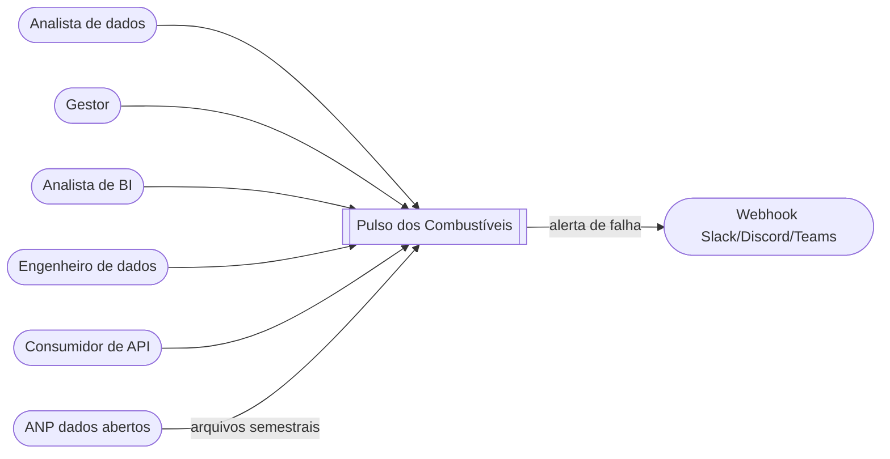

---

## 3. Requisitos

### 3.1 Funcionais
| ID | Requisito | Módulo |
|---|---|---|
| RF01 | Baixar semestres da ANP (`.zip` ou `.csv`) de forma agendada (semanal) | ETL |
| RF02 | Carga **incremental**: só semestres novos + semestre corrente | ETL |
| RF03 | Reprocessamento **idempotente** (`force`) sem duplicar dados | ETL |
| RF04 | Validar e limpar dados; rejeitar linhas inválidas e abortar se rejeição > 5% | ETL |
| RF05 | Alertar em caso de falha (log + webhook opcional) | ETL |
| RF06 | Expor coletas paginadas com filtros (produto, UF, município, período) | API |
| RF07 | Expor ranking de UFs vs. média nacional e série mensal por UF | API |
| RF08 | Autenticar via login e proteger todos os endpoints de dados (JWT) | API |
| RF09 | Documentar a API via Swagger/OpenAPI | API |
| RF10 | Painel com filtros, gráficos, tabela paginada e **exportação CSV** | Web |
| RF11 | Relatório Power BI conectado ao mesmo banco | BI |
| RF12–RF16 | **Alertas de preço**: regras configuráveis, avaliação automática via fila, severidade, DLQ — detalhes e regras de negócio em [`REQUISITOS.md`](REQUISITOS.md) | API / Fila |

### 3.2 Não funcionais
| ID | Requisito | Como é atendido |
|---|---|---|
| RNF01 | Subir tudo com poucos comandos | Docker Compose |
| RNF02 | **Mobile-first** e animações fluidas | CSS/Chart.js, View Transitions, `prefers-reduced-motion` |
| RNF03 | Consultas analíticas rápidas | Star schema, índices, matview |
| RNF04 | Reexecução segura | Upserts por chave natural, staging limpo por arquivo |
| RNF05 | Observabilidade de falhas | Estado por task no Airflow, callback de alerta |
| RNF06 | Qualidade automatizada | Testes + CI no GitHub Actions |
| RNF07 | Manutenibilidade | Módulos com fronteiras claras |

---

## 4. Casos de uso

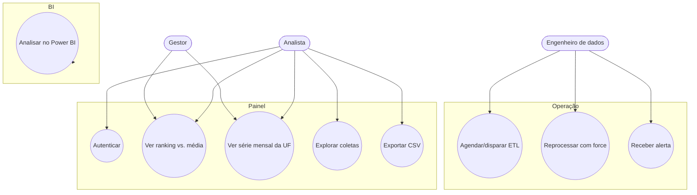

| Caso de uso | Pré-condição | Fluxo principal | Pós-condição |
|---|---|---|---|
| **UC1 Autenticar** | Usuário configurado na API | Informa usuário/senha → API valida → devolve JWT (60 min) → painel guarda em `sessionStorage` | Rotas protegidas liberadas |
| **UC2 Ver ranking** | Autenticado; DW carregado | Escolhe produto → API devolve UFs ordenadas por `variacao_pct` do mês mais recente | KPIs e barras animadas exibidos |
| **UC3 Ver série** | UC2 concluído | Toca numa UF → API devolve série mensal UF × Brasil | Gráfico de linha atualizado |
| **UC4 Explorar** | Autenticado | Define filtros → API pagina resultados | Lista de coletas |
| **UC5 Exportar CSV** | Há dados na tela | Painel gera CSV (UTF-8 BOM, `;`) no cliente | Arquivo baixado |
| **UC6/7 ETL** | DAG ativa | Agendamento semanal ou disparo manual (`force` opcional) | DW atualizado |
| **UC8 Alerta** | Task falhou após retries | Callback registra log e posta no webhook | Operador notificado |

*Fluxos de exceção:* credenciais inválidas → 401 com mensagem; token expirado → painel faz logout e volta ao login; `size` > 200 → 400; arquivo da ANP ausente (404) → semestre ignorado, sem falha.

---

## 5. Processos

### 5.1 Processo ETL (Airflow)

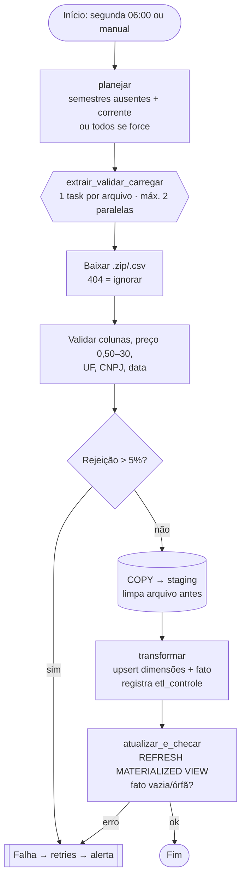

**Garantias**
- *Incremental:* `dw.etl_controle` registra arquivos já carregados.
- *Idempotente:* `DELETE` do staging por arquivo + `ON CONFLICT (data_id, revenda_id, produto_id) DO UPDATE`.
- *Resiliente:* 2 retries com intervalo de 5 min; `max_active_runs = 1`.
- *Auditável:* linhas lidas/válidas por arquivo.

### 5.2 Processo de autenticação

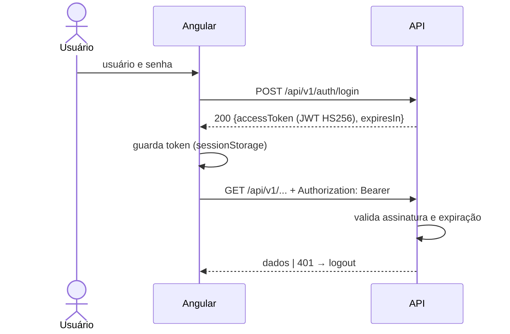

### 5.3 Processo de consulta analítica

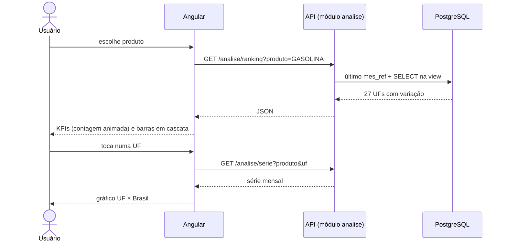

---

## 6. Visões da arquitetura

### 6.1 Visão de contexto (C4 nível 1)

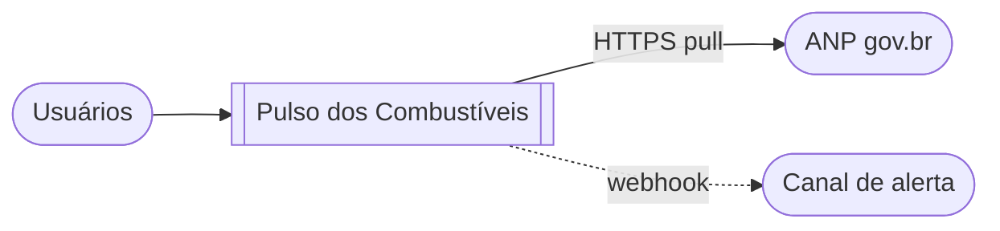

### 6.2 Visão de contêineres (C4 nível 2)

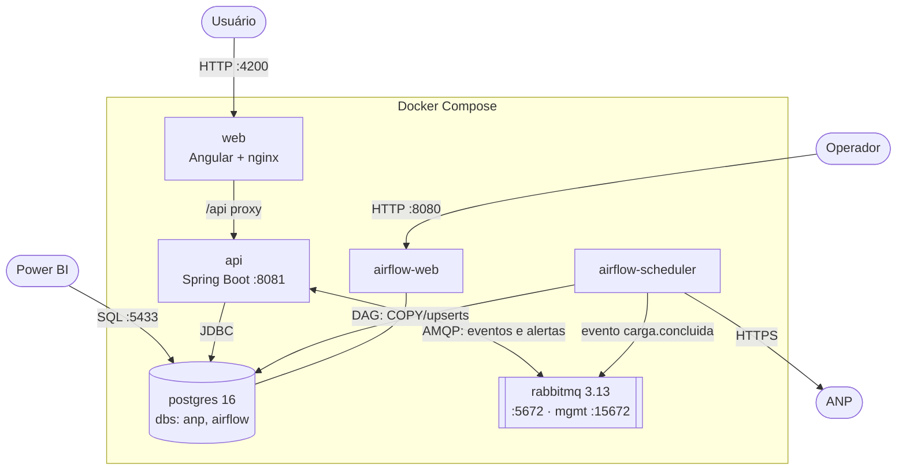

| Contêiner | Responsabilidade | Tecnologia |
|---|---|---|
| `web` | Servir SPA e fazer proxy de `/api` | Angular 22, nginx |
| `api` | Regras de acesso a dados, segurança, Swagger | Java 21, Spring Boot 3.4 |
| `airflow-scheduler` / `-web` | Orquestrar e monitorar o ETL | Airflow 2.10 |
| `postgres` | Staging, DW, metadados do Airflow e regras/alertas | PostgreSQL 16 |
| `rabbitmq` | Eventos entre ETL e API; DLQ — ver [`MENSAGERIA.md`](MENSAGERIA.md) | RabbitMQ 3.13 |

### 6.3 Visão de componentes (módulos)

**API — monolito modular**
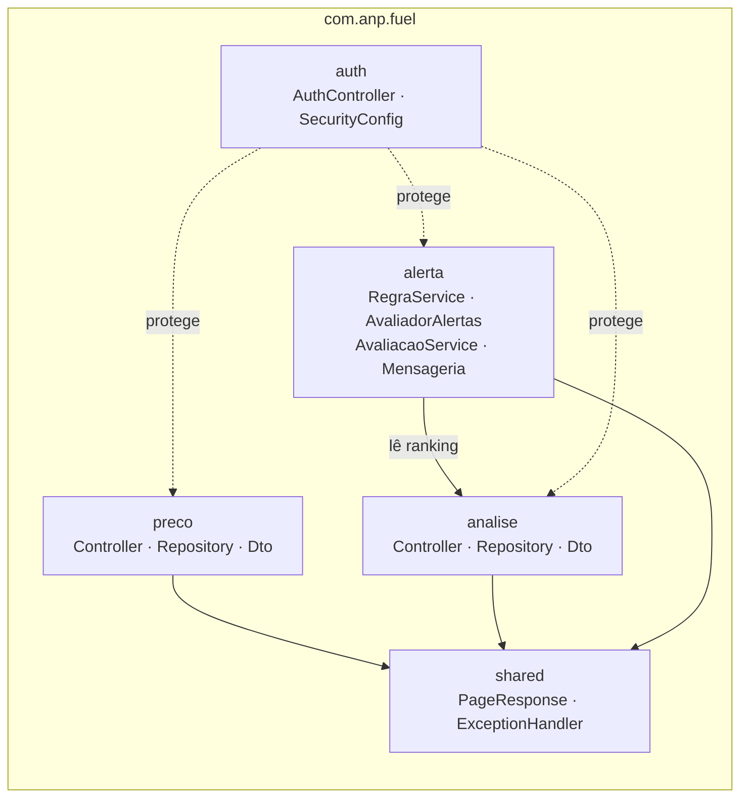

Dentro de `alerta`: **núcleo puro** (`AvaliadorAlertas`, `Severidade`, records) ← **serviços** (`RegraService`, `AvaliacaoService`) ← **portas** (`RegraRepository`, `AlertaRepository`, `Mensageria`) ← **adaptadores** (`Jdbc*Repository`, `RabbitMensageria`, consumidores, `AlertaController`).

**Painel — monolito modular**
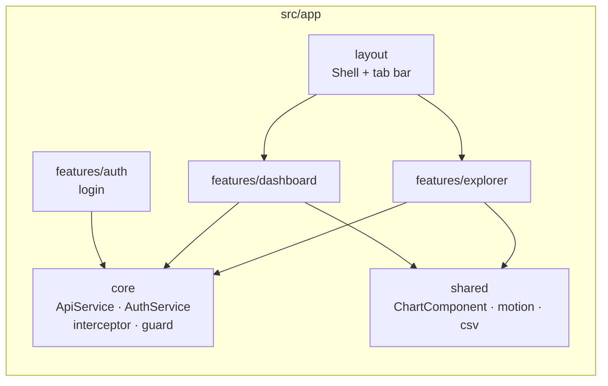
Regra de dependência: *features* dependem de `core` e `shared`, nunca entre si; rotas são carregadas sob demanda (`loadComponent`).

### 6.4 Visão de dados

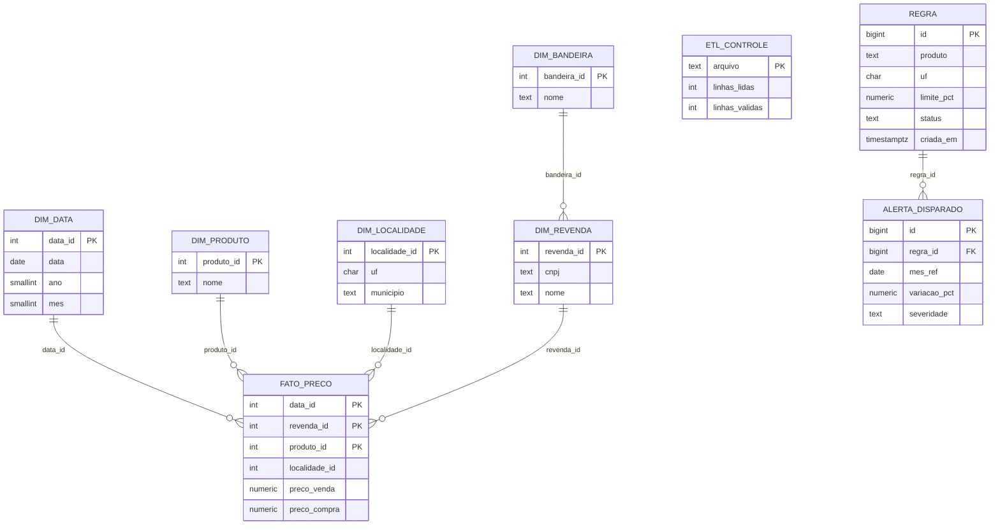

Módulo de alertas (schema `alerta`): `REGRA` guarda a configuração; `ALERTA_DISPARADO` tem `UNIQUE (regra_id, mes_ref)` — garante um alerta por regra/mês mesmo com mensagens repetidas. Índice parcial único `(produto, uf) WHERE status='ATIVA'` impede regras ativas duplicadas.

**Camadas:** `staging.stg_preco` (dado tipado, transitório) → `dw.*` (dimensões + fato) → `dw.mv_preco_mensal_uf` (agregado materializado) → `dw.vw_preco_vs_media_nacional` (média nacional ponderada, `variacao_pct`, `acima_da_media`).

### 6.5 Visão de implantação

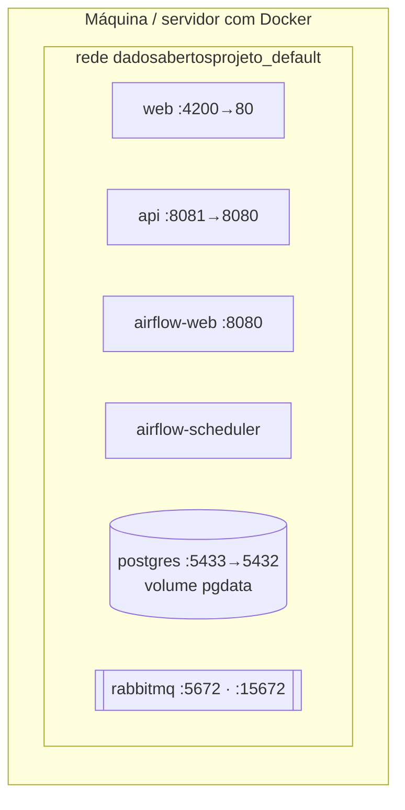
Um único `docker-compose.yml`. Persistência no volume `pgdata`. DAGs montadas como volume (`./airflow/dags`), permitindo editar sem rebuild.

### 6.6 Visão de API

| Método | Endpoint | Descrição |
|---|---|---|
| POST | `/api/v1/auth/login` | Emite JWT (público) |
| GET | `/api/v1/precos` | Coletas paginadas; filtros `produto, uf, municipio, de, ate, page, size(≤200)` |
| GET | `/api/v1/analise/ranking` | UFs × média nacional (`produto`, `mes` opcional) |
| GET | `/api/v1/analise/serie` | Série mensal de uma UF |
| GET | `/api/v1/analise/produtos` · `/ufs` | Listas para filtros |
| POST/GET | `/api/v1/alertas/regras` | Cria (201/409/422) e lista regras de alerta |
| GET/DELETE | `/api/v1/alertas/regras/{id}` | Busca / remove (404 se não existe) |
| POST | `/api/v1/alertas/regras/{id}/pausar` · `/ativar` | Altera status (idempotente) |
| GET | `/api/v1/alertas?limite=` | Alertas disparados, mais recentes primeiro |
| POST | `/api/v1/alertas/avaliacoes` | Enfileira avaliação (202), `mes` opcional |
| GET | `/actuator/health` · `/swagger-ui.html` | Saúde e documentação (públicos) |

Paginação padrão: `{content, page, size, totalElements, totalPages}`. Erros de validação → `400`; sem/expirado token → `401`.

---

## 7. Decisões arquiteturais (ADRs)

| # | Decisão | Alternativas | Justificativa | Consequência |
|---|---|---|---|---|
| 1 | **Airflow** para ETL | cron, scripts avulsos | Retries, estado por task, mapeamento dinâmico, alerta | Mais infra (scheduler + web) |
| 2 | **Modelo dimensional** | Tabela única plana | Consultas analíticas simples, reuso no BI | Mais etapas de carga |
| 3 | **Matview + view** analítica | Agregar na hora na API | Leitura barata sobre >1 mi de linhas | Exige `REFRESH` ao fim da DAG |
| 4 | **Upsert por chave natural** | Truncate + reload | Idempotência sem janela de indisponibilidade | Custo de índice na fato |
| 5 | **Monolito modular** | Microsserviços | Escopo pequeno; menor custo operacional; fronteiras preservadas | Evolução para serviços exigiria extrair módulos |
| 6 | **JWT stateless** com usuário único | Sessão, OAuth/IdP | Simplicidade para demo | Em produção, trocar por IdP |
| 7 | **`JdbcClient`** (sem JPA) | JPA/Hibernate | Consultas analíticas read-only, SQL explícito | Mapeamento manual |
| 8 | **Chart.js + CSS** para animação | `@angular/animations`, ECharts | Bundle menor, animações GPU-friendly | Menos abstrações prontas |
| 9 | **nginx faz proxy de `/api`** | CORS direto | Mesma origem, sem exposição de CORS no front | Config adicional no nginx |
| 10 | **Postgres único** com 2 bancos | Servidores separados | Simplicidade local | Em produção, separar metadados e DW |
| 11 | **RabbitMQ** para o evento "carga concluída" | Chamada HTTP direta ETL→API; polling no banco | ETL não conhece a API; retry e DLQ nativos; reprocessável | Mais um componente para operar — ver [`MENSAGERIA.md`](MENSAGERIA.md) |
| 12 | **Portas e núcleo puro** no módulo `alerta` (`Mensageria`, `RegraRepository`, `AvaliadorAlertas`) | Chamar Spring AMQP/JDBC direto no serviço | Regras de negócio testadas sem infraestrutura (100 % de cobertura) | Interfaces extras |
| 13 | **Idempotência por restrição de banco** (`UNIQUE (regra_id, mes_ref)`, índice parcial de regra ativa) | Checar no código antes de gravar | Correto sob concorrência e com entrega *at-least-once* | Exceção de chave duplicada vira fluxo normal |

---

## 8. Segurança

| Tema | Tratamento |
|---|---|
| Autenticação | JWT HS256, TTL 60 min, segredo via `JWT_SECRET` |
| Autorização | Todos os endpoints de dados exigem token; apenas login, health e docs são públicos |
| Entrada | Validação (`@Min/@Max`), consultas **parametrizadas** (sem concatenação de valores) |
| CORS | Origens configuráveis (`CORS_ORIGINS`) |
| Segredos | Via variáveis de ambiente; os valores padrão do Compose são **apenas para demo** |
| Dados | Públicos (ANP); CNPJs de revendas são dados de pessoa jurídica abertos |
| Front | Token em `sessionStorage` (cai ao fechar a aba); logout automático em 401 |

---

## 9. Qualidade e operação

- **Testes:** 74 de API (regras de negócio, contrato HTTP, segurança/CORS, repositórios em H2, mensageria) com **100 % de linhas e de branches** exigidos pelo JaCoCo no build; 23 de painel (API client, auth/interceptor/guard, login, diretivas de animação, CSV); 24 de ETL (helpers e publicação do evento); ETL também validado com carga real (1.227.029 linhas) e reexecução idempotente.
- **CI** (GitHub Actions): `mvn verify` (com *gate* de cobertura), `ng test` + `ng build`, `ruff` + `pytest` + compilação da DAG, `docker compose config`.
- **Operação:** reprocessar = *trigger* da DAG com `{"force": true}`; falhas aparecem por task na UI do Airflow e no webhook.
- **Métricas de referência (ambiente local):** carga de ~3 semestres em ~3 min; painel inicial ≈ 93 kB transferidos (gzip) e rotas lazy.

---

## 10. Riscos e limitações

| Risco / limitação | Impacto | Mitigação / próximo passo |
|---|---|---|
| ANP altera URL/formato dos arquivos | ETL passa a ignorar (404) ou falhar | Variável `ANP_BASE_URL`; alerta; checagem de colunas obrigatórias |
| Semestre corrente ainda inexistente | Ignorado sem erro | Comportamento esperado |
| Paginação por `OFFSET` em tabela grande | Páginas profundas lentas | Keyset pagination se necessário |
| Autenticação de usuário único | Não serve para produção | Integrar IdP (OIDC) |
| Relatório Power BI | `.pbix` ainda não incluído | Seguir [guia](../powerbi/README.md) |
| Sem monitoramento de métricas da API | Pouca visibilidade em produção | Expor Prometheus via Actuator |
| Alertas só notificam em log; regras globais; produto não validado contra o catálogo | Ver [`REQUISITOS.md` §10](REQUISITOS.md) | Canal real de notificação, regra por usuário, validação de produto |
| Painel Angular ainda sem tela de alertas; páginas `dashboard`/`explorer` sem teste de componente | Funcionalidade só via API/Swagger | Tela de regras e testes de componente |

---

## 11. Glossário

| Termo | Significado |
|---|---|
| **ANP** | Agência Nacional do Petróleo, Gás Natural e Biocombustíveis |
| **DAG** | Grafo acíclico de tarefas do Airflow |
| **Fato / Dimensão** | Tabela de medidas / tabela descritiva em um modelo estrela |
| **Matview** | *Materialized view*: resultado de consulta armazenado |
| **Idempotência** | Executar N vezes produz o mesmo estado que executar 1 vez |
| **`variacao_pct`** | `(preço médio da UF ÷ média nacional ponderada) − 1`, em % |
| **Monolito modular** | Um único artefato implantável com módulos internos de fronteiras claras |
