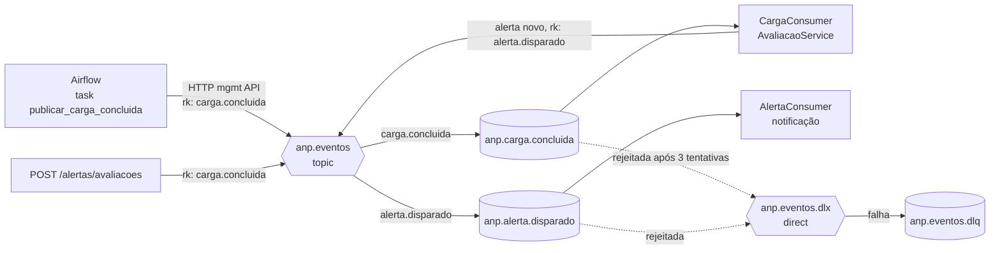

# Mensageria — RabbitMQ

Desacopla **quem produz dados** (ETL) de **quem reage a eles** (avaliação de alertas). O ETL só anuncia *"carga concluída"*; não conhece a API.

## Topologia



| Elemento | Nome | Observação |
|---|---|---|
| Exchange principal | `anp.eventos` (topic, durável) | Declarada pela API no boot (`MensageriaConfig`) |
| Fila de entrada | `anp.carga.concluida` | Chave `carga.concluida` |
| Fila de saída | `anp.alerta.disparado` | Chave `alerta.disparado` |
| Dead-letter | `anp.eventos.dlx` → `anp.eventos.dlq` | Chave `falha` |

## Contratos (JSON)

```jsonc
// carga.concluida — mesRef é opcional; vazio {} = "mês mais recente de cada produto"
{ "mesRef": "2026-06-01" }

// alerta.disparado
{ "id": 1, "regraId": 2, "produto": "GASOLINA", "uf": "RR", "mesRef": "2026-06-01",
  "variacaoPct": 15.31, "limitePct": 5.00, "severidade": "CRITICA", "criadoEm": "2026-11-14T16:41:02Z" }
```

O conversor infere o tipo pelo parâmetro do `@RabbitListener`, então produtores externos (como o Airflow) **não** precisam enviar cabeçalho de tipo Java.

## Garantias e falhas

| Cenário | Comportamento |
|---|---|
| Entrega | *At-least-once* (ack após o método terminar) |
| Mensagem repetida | **Segura** — RN06: no máximo um alerta por regra/mês (`UNIQUE` no banco) |
| Consumidor lança exceção | 3 tentativas com *backoff* (1 s, 2 s); depois `default-requeue-rejected: false` → **DLQ** |
| Broker fora durante a carga | A task do Airflow só registra aviso; a carga continua válida (RNF09) |
| Broker fora ao pedir reavaliação | `POST /alertas/avaliacoes` falha (500); nada é perdido porque nada foi aceito |
| Reprocessar a DLQ | Painel do RabbitMQ → *Move messages* para `anp.eventos` com chave `carga.concluida` |

## Operação

```bash
docker compose up -d --build rabbitmq api     # painel do broker: http://localhost:15672 (guest/guest)

# publicar o evento "na mão", como a DAG faz:
curl -u guest:guest -X POST http://localhost:15672/api/exchanges/%2F/anp.eventos/publish \
  -H 'Content-Type: application/json' \
  -d '{"properties":{"content_type":"application/json"},"routing_key":"carga.concluida","payload":"{}","payload_encoding":"string"}'
# → {"routed":true}
```

Bancos já existentes **não** reexecutam `db/init`; aplique o módulo manualmente:
`docker compose exec -T postgres psql -U anp -d anp < db/init/02_alertas.sql`

## Variáveis

| Variável | Padrão | Uso |
|---|---|---|
| `RABBIT_HOST` / `RABBIT_PORT` / `RABBIT_USER` / `RABBIT_PASSWORD` | `localhost` / `5672` / `guest` / `guest` | Conexão da API |
| `MENSAGERIA_ENABLED` | `true` | `false` troca o publicador por um *no-op* com log (sem broker, sem consumidores) |
| `RABBITMQ_MGMT_URL` | vazio | Se vazio, a DAG não publica evento |

## Decisões

- **Porta `Mensageria`:** a regra de negócio depende de uma interface, não do Spring AMQP — por isso é testável sem broker.
- **DAG publica via HTTP (API de gerenciamento):** evita instalar `pika` na imagem do Airflow; aceitável porque a publicação é *best-effort*. Em produção, preferir um *provider* AMQP.
- **Tipo inferido no consumidor:** contrato JSON simples, independente de linguagem.
