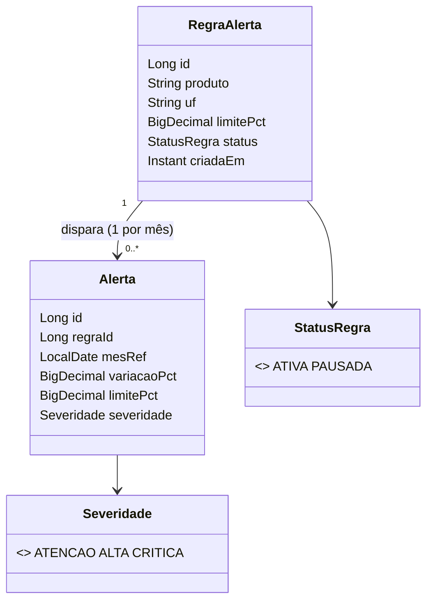
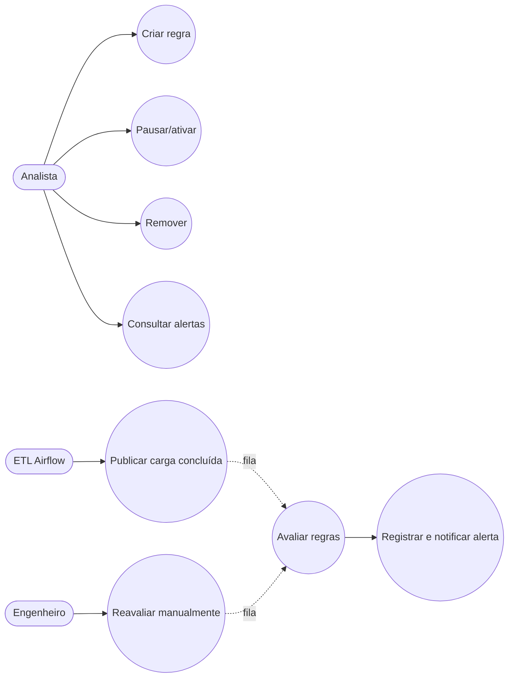

# Análise de Requisitos — Módulo de Alertas de Preço

> Complementa o [Documento de Arquitetura](ARQUITETURA.md). Cobre o que o sistema **deve fazer** (negócio) antes de **como** (arquitetura).

## 1. Contexto e problema

O painel responde *"onde o preço está acima da média nacional?"*, mas obriga o usuário a **voltar e olhar**. Quem acompanha o mercado (analista de preços, gestor de frota, jornalista de dados) quer o oposto: ser **avisado** quando uma UF ultrapassar um limite que ele definiu.

**Objetivo:** permitir cadastrar regras de alerta e disparar avisos automaticamente a cada carga nova de dados, sem o usuário precisar consultar o painel.

**Fora do escopo (v1):** entrega por e-mail/SMS/push (há um ponto de extensão, ver [MENSAGERIA.md](MENSAGERIA.md)), multiusuário (as regras são globais, pois a autenticação é de usuário único), alertas de queda de preço, regras por município.

## 2. Partes interessadas

| Parte | Interesse | Como participa |
|---|---|---|
| Analista de preços | Saber cedo que uma UF disparou | Cria/pausa regras, consulta alertas |
| Gestor | Priorizar o que é grave | Lê a **severidade** do alerta |
| Engenheiro de dados | Pipeline confiável e observável | Opera ETL, fila e DLQ |

## 3. Histórias de usuário e critérios de aceite

| ID | História | Critérios de aceite (Dado / Quando / Então) |
|---|---|---|
| **US01** | Como analista, quero **criar uma regra** "avise quando *produto* na *UF* passar *X%* acima da média nacional" | Dado produto, UF válida e X em (0, 100] · Quando crio · Então recebo `201` com a regra `ATIVA` e `Location` |
| **US02** | Como analista, quero **pausar e reativar** uma regra sem perdê-la | Quando pauso · Então ela deixa de gerar alertas · Quando reativo · Então volta a valer, respeitando RN03/RN04 |
| **US03** | Como analista, quero **remover** uma regra | Quando removo · Então `204`; removendo de novo, `404` |
| **US04** | Como analista, quero ser **avisado automaticamente** quando a carga de dados terminar | Dado regra ativa · Quando o ETL conclui · Então, se a UF excede o limite, um alerta é criado **uma única vez** por regra/mês |
| **US05** | Como gestor, quero ver a **gravidade** do alerta | Então cada alerta traz `ATENCAO`, `ALTA` ou `CRITICA` conforme RN07 |
| **US06** | Como analista, quero **consultar** os alertas recentes | Quando listo · Então vêm do mais novo ao mais antigo, com `limite` entre 1 e 200 |
| **US07** | Como engenheiro, quero que uma **falha** ao avaliar não perca o evento | Então a mensagem é reenviada (3 tentativas) e, esgotadas, vai à **DLQ** para análise |
| **US08** | Como engenheiro, quero **reavaliar** manualmente | Quando `POST /alertas/avaliacoes` · Então `202` e a avaliação roda de forma assíncrona |

## 4. Regras de negócio

| ID | Regra | Onde é imposta |
|---|---|---|
| **RN01** | Produto é obrigatório; UF deve ser uma das 27 UFs. Produto e UF são normalizados (maiúsculas, sem espaços nas pontas) | `RegraService.criar` |
| **RN02** | O limite deve estar em (0, 100] — zero e negativos não fazem sentido; acima de 100 % é irrealista | `RegraService.criar` + Bean Validation + `CHECK` no banco |
| **RN03** | No máximo **uma regra ativa** por produto/UF; regras pausadas não contam | `RegraService` + índice único parcial (vale sob concorrência) |
| **RN04** | No máximo **10 regras ativas** no total (evita avaliação desmedida) | `RegraService` |
| **RN05** | Ativar e pausar são **idempotentes**; reativar obedece RN03 e RN04 | `RegraService.ativar/pausar` |
| **RN06** | Um alerta dispara quando a UF está **acima da média nacional** **e** `variação ≥ limite` (igualdade dispara). Cada regra alerta **no máximo uma vez por mês de referência** | `AvaliadorAlertas` + `UNIQUE (regra_id, mes_ref)` |
| **RN07** | Severidade = `variação ÷ limite`: `< 1,5` → **ATENÇÃO**, `[1,5 ; 2)` → **ALTA**, `≥ 2` → **CRÍTICA** | `Severidade.de` |
| **RN08** | A avaliação usa o **mês mais recente** de cada produto, salvo mês informado (normalizado para o dia 1). Produto sem dados é ignorado, sem erro | `AvaliacaoService` |
| **RN09** | Excluir uma regra apaga seu histórico de alertas (`ON DELETE CASCADE`) | `db/init/02_alertas.sql` |

## 5. Requisitos

**Funcionais** (continuam a numeração do documento de arquitetura)

| ID | Requisito | Histórias |
|---|---|---|
| RF12 | CRUD parcial de regras de alerta (criar, listar, buscar, pausar, ativar, remover) | US01–US03 |
| RF13 | Avaliar regras automaticamente ao fim da carga, via mensageria | US04, US05 |
| RF14 | Consultar alertas disparados, paginados por limite | US06 |
| RF15 | Disparar reavaliação manual de forma assíncrona | US08 |
| RF16 | Mensagens que falham são reenfileiradas e, por fim, isoladas em DLQ | US07 |

**Não funcionais**

| ID | Requisito | Como é atendido |
|---|---|---|
| RNF08 | Acoplamento fraco entre ETL e API | Evento `carga.concluida` no RabbitMQ; o ETL não conhece a API |
| RNF09 | Falha de mensageria **não invalida** a carga | Task de publicação é *best-effort* (só log) |
| RNF10 | Reprocessar a mesma mensagem não duplica alertas | RN06 (idempotência por regra/mês) |
| RNF11 | Regras de negócio testáveis sem infraestrutura | Núcleo puro (`AvaliadorAlertas`), portas (`Mensageria`, repositórios) |
| RNF12 | Cobertura de testes da API = 100 % linhas / ≥ 90 % branches, imposta no build | JaCoCo `check` em `mvn verify` |

## 6. Modelo de domínio

Tabelas: `alerta.regra` e `alerta.alerta_disparado` (ver [`db/init/02_alertas.sql`](../db/init/02_alertas.sql)).

## 7. Casos de uso

**UC7 Avaliar regras — fluxo principal:** (1) recebe `carga.concluida`; (2) lista regras ativas agrupadas por produto; (3) para cada produto obtém o ranking do mês (RN08); (4) aplica RN06/RN07; (5) grava só os alertas inéditos; (6) publica cada um em `alerta.disparado`.
**Exceções:** sem dados para o produto → ignora e segue (RN08); alerta já existente no mês → não republica (RN06); erro inesperado → retentativas e DLQ (RF16).

## 8. API (resumo)

| Método e rota | Sucesso | Erros |
|---|---|---|
| `POST /api/v1/alertas/regras` | 201 + `Location` | 400 formato · 409 duplicada (RN03) · 422 regra de negócio (RN01/02/04) |
| `GET /api/v1/alertas/regras[/{id}]` | 200 | 404 |
| `POST /api/v1/alertas/regras/{id}/pausar` · `/ativar` | 200 | 404 · 409/422 ao reativar |
| `DELETE /api/v1/alertas/regras/{id}` | 204 | 404 |
| `GET /api/v1/alertas?limite=50` | 200 | 400 (limite fora de 1–200) |
| `POST /api/v1/alertas/avaliacoes[?mes=AAAA-MM-DD]` | 202 | — |

Todos exigem JWT (401 sem token). Contrato completo em `/swagger-ui.html`.

## 9. Rastreabilidade: requisito → teste

| Regra / requisito | Testes que a verificam |
|---|---|
| RN01 | `RegraServiceTest` (`criaRegraNormalizandoProdutoEUf`, `produtoObrigatorio`, `ufDeveSerValida`) |
| RN02 | `RegraServiceTest.limiteDeveEstarEntreZeroExclusivoECem` · `AlertaApiTest.corpoInvalidoRetorna400` |
| RN03 | `RegraServiceTest` (`naoPermiteDuasRegrasAtivas…`, `corridaDeCriacaoViraDuplicada`, `reativarRespeitaUnicidade`) · `AlertaApiTest.regraDuplicadaRetorna409` |
| RN04 | `RegraServiceTest` (`limitaDezRegrasAtivas`, `reativarRespeitaLimiteDeDez`) |
| RN05 | `RegraServiceTest.pausarEAtivarSaoIdempotentes` |
| RN06 | `AvaliadorAlertasTest` (limite exato, abaixo, fora da média, pausada…) · `AvaliacaoServiceTest.reavaliarOMesmoMesNaoDuplicaAlerta` · `RepositoriosJdbcTest.alertaRegistraDeduplicaEListaRecentes` |
| RN07 | `SeveridadeTest` (fronteiras 1,5 e 2) |
| RN08 | `AvaliacaoServiceTest` (`mesNuloUsaOMaisRecente…`, `mesExplicitoEhNormalizado…`, `produtoSemDadosEhIgnorado`) |
| RF12/RF14/RF15 | `AlertaApiTest` (contrato HTTP, 401, 404, 409, 422, 202) |
| RF13 / fluxo completo | `RepositoriosJdbcTest.fluxoRegraAvaliacaoAlertaComBancoReal` · verificado manualmente contra RabbitMQ + Postgres reais |
| RF16 / RNF08 | `MensageriaTest` (topologia com DLX, conversor JSON, consumidores) · `application.yml` (retry) |
| RNF09 | `test_anp_etl.py::test_falha_de_mensageria_nao_quebra_a_carga` |

## 10. Riscos e perguntas em aberto

| Item | Impacto | Encaminhamento |
|---|---|---|
| Nome de produto não é validado contra o catálogo (`dim_produto`) | Regra com produto inexistente nunca dispara | Validar na criação (precisa de nova dependência no domínio) |
| Regras globais (sem dono) | Qualquer usuário autenticado vê/altera tudo | Associar regra ao usuário quando houver IdP |
| Notificação só em log | Alerta não chega ao usuário | Implementar canal real no `AlertaConsumer` (e-mail/Slack) |
| Sem *outbox*: gravar alerta e publicar não são atômicos | Raro: alerta salvo e não publicado | Padrão *transactional outbox* se a entrega virar requisito forte |
| Teste automatizado com broker real ausente | Topologia validada em unidade + manualmente | Testcontainers RabbitMQ no CI |
